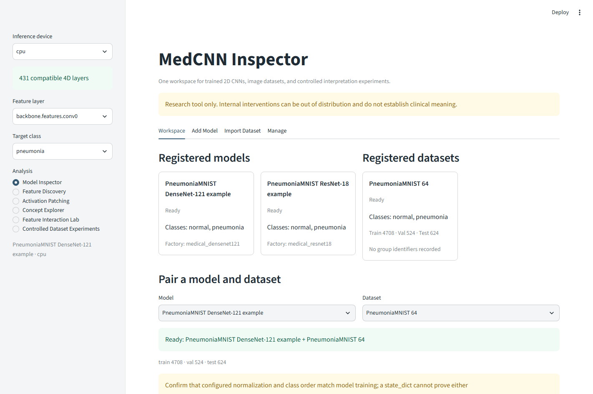
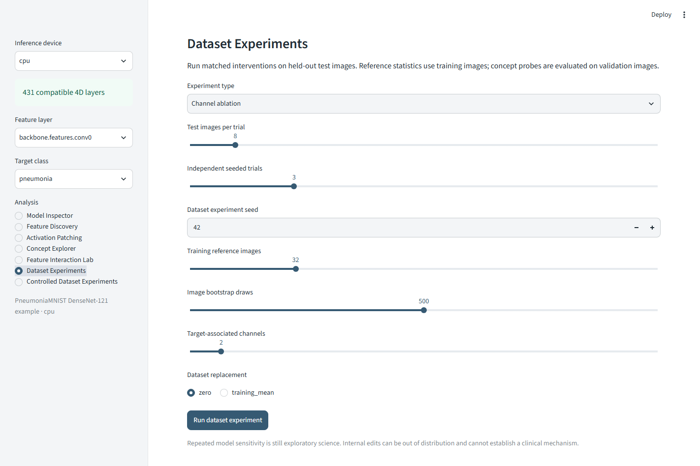

# MedCNN Inspector

MedCNN Inspector is a local workbench for trained **2D PyTorch classification CNNs**. Import a trusted tensor `state_dict`, pair it with an image dataset, explore 4D feature maps, and measure how internal edits change real model predictions. ResNet-18 and DenseNet-121 pneumonia classifiers are available as optional examples. The standalone package does not use the presentation project's `src/` code.





## Install → Launch → Import Model → Import Dataset → Analyze

Use **Python 3.14** for the pinned lock file. From the standalone `MedCNN-Inspector/` directory:

**Windows PowerShell**

```powershell
py -3.14 -m venv .venv
.\.venv\Scripts\python.exe -m pip install --upgrade pip
.\.venv\Scripts\python.exe -m pip install torch==2.15.0 torchvision==0.29.2 --index-url https://download.pytorch.org/whl/cpu
.\.venv\Scripts\python.exe -m pip install -r requirements.lock.txt
.\.venv\Scripts\python.exe -m streamlit run app.py
```

**Linux**

```bash
python3.14 -m venv .venv
.venv/bin/python -m pip install --upgrade pip
.venv/bin/python -m pip install torch==2.15.0 torchvision==0.29.2 --index-url https://download.pytorch.org/whl/cpu
.venv/bin/python -m pip install -r requirements.lock.txt
.venv/bin/python -m streamlit run app.py
```

In the parent development workspace, launch `medcnn_app.py` instead of `app.py`. **Launch does not train or prepare pneumonia models.** Missing example checkpoints simply show as unavailable; you can import your own model and dataset immediately. Choosing the built-in PneumoniaMNIST dataset downloads it if needed.

## Five-minute walkthrough

1. Open **Add Model**. Choose ResNet-18, DenseNet-121, EfficientNet-B0, VGG-16, or a factory registered in your trusted local `medcnn/local_models.py`. Select a local `.pt`/`.pth` tensor `state_dict` or upload it. Enter the exact class order, image dimensions, channels, normalization, and output format. If known, record training provenance and confirm settings against training records.
2. Open **Import Dataset**. Point to class folders, a ZIP archive, or a CSV with image paths and labels. Use existing train/val/test splits or generate seeded splits. Supply patient/group IDs through CSV when available.
3. In **Workspace**, select the model and dataset cards. Read the separate **technical compatibility** result and **scientific checklist**. Label names and inference shapes are checked; training-time normalization, class order, and provenance are user declarations.
4. Choose a feature layer and target class in the sidebar. Inspect architecture, activation maps, top examples, and the single-image patching, concept, or interaction views.
5. Open **Dataset Experiments**. Choose channel ablation, activation patching, or a class-label concept direction. Set sample size, trials, seed, and controls, then run. Compare paired per-image effects, image-bootstrap intervals, random controls, and stability. Download CSV/PNG/JSON; completed runs also save under `workspace_registry/experiments/`.

The pneumonia examples also retain **Controlled Dataset Experiments**, the earlier full-data top/low/random channel study, for continuity with saved results.

## Inputs and research boundaries

| Input | Accepted form |
|---|---|
| Model | Trusted local 2D CNN factory plus a tensor `state_dict`; strict weight matching and `torch.load(..., weights_only=True)`. Uploaded Python code and pickled whole-model modules are not executed. |
| Dataset | `class/image.png` folders; `train/class/image.png`, `val/class/image.png`, `test/class/image.png`; ZIP of those folders or one CSV manifest; or CSV labels with image paths relative to an image root. |
| Output | Binary or multiclass classification scores, logits or probabilities, with 4D intermediate `N,C,H,W` maps and 1- or 3-channel images. |

Generated splits use fixed seeds. Supplied group IDs and decoded image contents are checked for cross-split overlap at import. General experiments fit channel statistics and class-label directions on **training** images, evaluate concept probes on **validation** images, and measure interventions on **test** images. Selected image contents are checked again during experiments, including older imports without stored hashes. Repeated trials reuse test images when the test set is small; confidence intervals resample distinct images after averaging repeated appearances.

The model–dataset checklist distinguishes executable compatibility from scientific validity. A `state_dict` cannot prove its preprocessing, class order, training data, or patient identity. Class-label concept directions are **label associations**, not automatically identified clinical concepts. Activation edits can be out of distribution. Neither association nor intervention sensitivity proves a clinical mechanism or supports diagnosis.

## Documentation

- [Advanced setup and model integration](medcnn/docs/ADVANCED.md): trusted custom factories, dataset layouts, example preparation, CLI experiments, and local storage.
- [Methods and interpretation](medcnn/docs/METHODS.md): controls, confidence intervals, stability, split integrity, and limitations.
- [Validation report](medcnn/docs/VALIDATION.md): executed tests and saved-model checks.
- [Release audit](medcnn/docs/RELEASE_AUDIT.md): passed checks, remaining limits, and the cross-platform verification gate.

## License and attribution

Project code is MIT licensed; see [LICENSE](LICENSE). PneumoniaMNIST is provided by [MedMNIST](https://github.com/MedMNIST/MedMNIST) under CC BY 4.0; cite Yang et al., *Scientific Data* 10, 41 (2023), and the source chest X-ray work by Kermany et al., *Cell* 172, 1122–1131 (2018). MedMNIST code is Apache-2.0; [Torchvision](https://github.com/pytorch/vision/blob/main/LICENSE) is BSD-3-Clause. Downloaded weights and datasets retain their own terms. Local checkpoints, imports, and caches are excluded from Git.
